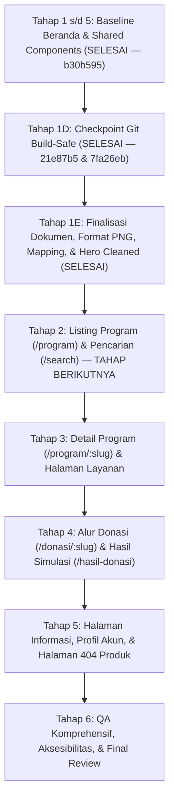

# OpenDonasi — Dokumen Rencana Implementasi & Arsitektur Frontend (Tahap 2 - Revisi 1.1)

**Versi Dokumen:** 1.1 (Revisi Hasil Review)  
**Status:** Rencana Teknis Siap Review & Checkpoint  
**Target Rilis:** Prototype Frontend OpenDonasi v1.0  
**Acuan Utama:** `OPENDONASI_SPEC.md`, `DESIGN_SYSTEM.md`, `GEMINI.md`, Laporan Audit Tahap 1, dan Hasil Review Revisi Tahap 2  

---

## DAFTAR ISI
1. [A. Ringkasan Kondisi Proyek](#a-ringkasan-kondisi-proyek)
2. [B. Matriks Seluruh 16 Halaman](#b-matriks-seluruh-16-halaman)
3. [C. Peta Navigasi Desktop dan Mobile](#c-peta-navigasi-desktop-dan-mobile)
4. [D. Rekomendasi Arsitektur Frontend](#d-rekomendasi-arsitektur-frontend)
5. [E. Inventaris Komponen Reusable](#e-inventaris-komponen-reusable)
6. [F. Rencana Data Mock dan Relasi Data](#f-rencana-data-mock-dan-relasi-data)
7. [G. Matriks Pemetaan Aset](#g-matriks-pemetaan-aset)
8. [H. Rencana Tahapan Implementasi & Checkpoint](#h-rencana-tahapan-implementasi--checkpoint)
9. [I. Checklist QA dan Aksesibilitas Konkret](#i-checklist-qa-dan-aksesibilitas-konkret)
10. [J. Daftar Keputusan Terbuka dan Risiko](#j-daftar-keputusan-terbuka-dan-risiko)

---

## A. Ringkasan Kondisi Proyek

### 1. Fakta Proyek Aktual (Status Baseline Tahap 1D & 1E)
- **Teknologi Eksisting:** React 19 (`19.2.8`) + Vite 8 (`8.3.4`) + Tailwind CSS (`3.4.19`) + React Router (`7.18.4`).
- **Status Repository & Version Control:** Repositori Git aktif pada branch `master`. Commit checkpoint Tahap 1D telah terverifikasi (`21e87b5` dan `7fa26eb`). Seluruh aset lokal dan baseline terkunci secara aman.
- **Kondisi Kode Sumber:**
  - Halaman Beranda (`src/features/home/HomePage.jsx`) telah selesai diimplementasikan sebagai **baseline visual terkunci**.
  - Fondasi komponen bersama OpenDonasi (`CampaignCard`, `ProgressBar`, `Button`, `Badge`, `Header`, `Footer`, `MobileBottomNav`, `PosterCarousel`, `HeroCarousel`) telah berfungsi.
  - `HeroCarousel.jsx` telah dibersihkan dari overlay teks HTML dan gradasi gelap yang menimpa banner grafis, menjaga banner utuh (`object-contain`) dengan aksesibilitas screen reader (`sr-only`).
  - Mock data terpusat tersedia di `src/data/` (`campaigns.js`, `content.js`, `userHistory.js`).
  - Rute produk (`src/app/routes.jsx`) telah terdefinisi untuk 16 halaman, namun **15 rute selain Beranda masih berstatus rute placeholder** dan belum diimplementasikan.
- **Aset Visual & Standarisasi Format:**
  - Logo resmi: `src/assets/logo/logo.png` (warna brand `#2E7DFA`).
  - Gambar banner & program: 14 file gambar di `src/assets/image/banner/` (4 file) dan `src/assets/image/gambar/` (10 file) telah diverifikasi dan dikonversi ke **format PNG sejati** dengan mempertahankan dimensi piksel visual aslinya.
  - Ikon SVG di `src/assets/icons/` telah distandarisasi atribut `fill` ke warna brand `#2E7DFA`.
  - Ikon layanan Zakat menggunakan `src/assets/icons/icons_kategori/zakat.svg` sebagai **pengecualian sementara yang telah disetujui**.
  - Empat kampanye tanpa aset yang cocok (`camp-004`, `camp-006`, `camp-009`, `camp-010`) secara eksplisit ditandai secara internal sebagai `UNRESOLVED — ASSET BELUM TERSEDIA`.

### 2. Kesenjangan Faktual vs Target Arsitektur
- **Fitur & Halaman Tersedia:** 1 dari 16 halaman selesai (Beranda sebagai baseline). 15 halaman lainnya memerlukan implementasi bertahap.
- **Komponen Spesifik Halaman:** Filter popover katalog, sorting popover, mini kalkulator zakat, sticky detail sidebar, form donasi multi-step, dan bukti simulasi masih perlu dibangun.
- **Halaman 404:** Rute wildcard `*` saat ini masih menampilkan panel showcase komponen internal; perlu diwujudkan sebagai halaman 404 produk yang ramah pengguna dengan tombol kembali ke Beranda.

### 3. Tahap Implementasi Berikutnya
- **Tahap Aktif Selanjutnya (Tahap 2):** Implementasi katalog `/program` (grid 3 kolom, filter kategori reaktif, popover filter & sort, load more) dan halaman pencarian `/search`.
- **Tahap Lanjutan (Tahap 3 s/d 6):** Detail program `/program/:slug`, landing layanan (`/zakat`, `/infaq`, `/sedekah`, `/wakaf`), alur formulir donasi & hasil simulasi, serta halaman informasi & profil.

---

## B. Matriks Seluruh 16 Halaman

Berikut adalah spesifikasi teknis operasional untuk 16 halaman publik OpenDonasi sesuai bab 4 & 5 `OPENDONASI_SPEC.md`:

| No | Nama Halaman | Usulan URL/Route | Tujuan Halaman | Komponen Utama | Sumber Data Mock | Interaksi Spesifik yang Diwajibkan | Navigasi Masuk & Keluar | Kondisi UI / State | Kriteria Penerimaan yang Dapat Diuji |
| :---: | :--- | :--- | :--- | :--- | :--- | :--- | :--- | :--- | :--- |
| **01** | **Beranda** | `/` | Pintu gerbang utama untuk menjelajahi program unggulan, akses layanan, dan testimoni donatur. | `Navbar`, `HeroCarousel`, `ServiceQuickAccess`, `FeaturedCampaignCarousel`, `PosterCarousel`, `CategoryTabs`, `CampaignGrid`, `PrayerSupportCarousel`, `CtaBanner`, `Footer`, `MobileBottomNav` | `content.banners`, `content.services`, `campaigns`, `categories`, `content.prayers` | - Hero swipe/drag manual, autoplay ~6 detik, indikator titik di bawah, jeda otomatis setelah interaksi manual.<br>- Unggulan swipe/drag manual, tanpa autoplay, tombol panah navigasi samping desktop.<br>- Filter kategori memperbarui daftar program secara reaktif.<br>- Tombol Aamiin toggle lokal (+1 / -1) per sesi donatur. | **Masuk:** Default entry (`/`), klik logo header.<br>**Keluar:** Klik kartu ke `/program/:slug` (atau `/zakat/:slug`), layanan ke `/zakat`, `/infaq`, dll., tombol Lihat Selengkapnya ke `/program`. | - Loading skeleton grid.<br>- Empty state jika kategori yang dipilih tidak memiliki program aktif. | 1. Hero carousel bergeser otomatis ~6 detik dan menjeda pergeseran saat disentuh/digeser.<br>2. Carousel program unggulan tidak bergerak sendiri (manual only).<br>3. Grid program desktop menampilkan tepat 3 kolom dan 2 baris awal.<br>4. Mobile menampilkan kartu program horizontal.<br>5. Tidak ada horizontal scrollbar pada jendela browser. |
| **02** | **Daftar Program** | `/program` | Katalog pencarian, filtering, dan pengurutan seluruh program donasi umum. | `Navbar`, `PageHeader`, `CategoryFilterBar`, `FilterPopover`, `SortPopover`, `CampaignGrid`, `LoadMoreButton`, `Footer`, `MobileBottomNav` | `campaigns`, `categories` | - Filter kategori via tab horizontal.<br>- Popover Filter (target & sisa hari) dan Urutkan (terbaru, paling mendesak, dana terbanyak).<br>- Tombol "Lihat Selengkapnya" menambah item yang ditampilkan. | **Masuk:** Menu Navbar "Program", Tombol "Lihat Selengkapnya" Beranda.<br>**Keluar:** Klik kartu program ke `/program/:slug` (atau `/zakat/:slug`). | - Skeleton loader saat filtering.<br>- Empty state ramah donatur dengan tombol reset filter jika hasil nihil. | 1. Memilih opsi pada popover filter/urutkan langsung memperbarui daftar program.<br>2. Popover menutup saat klik di luar area (*click-outside*).<br>3. Status program (aktif/selesai) ditampilkan jelas dan terpisah maknanya dari status transaksi donatur. |
| **03** | **Detail Program Donasi** | `/program/:slug` | Menjelaskan narasi program umum, urgensi, progres dana, dan memfasilitasi donasi. | `Navbar`, `CampaignDetailHeader`, `CampaignMedia16x9`, `CampaignStory`, `CampaignUpdates`, `DonorList`, `CampaignSidebarSticky`, `StickyBottomMobileCta`, `ShareModal`, `Footer` | `campaigns[slug]`, `donations[campaignId]`, `campaignUpdates[campaignId]` | - Bilah progres dan nominal terkumpul selalu terlihat.<br>- Deskripsi panjang memiliki toggle "Lihat Selengkapnya".<br>- Sidebar desktop menempel (*sticky*) saat scroll.<br>- Sticky bar bawah mobile **hanya muncul setelah tombol donasi di area konten terlewat dari viewport**.<br>- Tombol Bagikan memicu Web Share API atau fallback salin tautan. | **Masuk:** Klik kartu dari Beranda, Listing, Hasil Pencarian, Landing Layanan.<br>**Keluar:** Tombol "Donasi Sekarang" mengarah ke `/donasi/:slug`. | - Loading detail skeleton.<br>- **404 Handling:** Jika slug tidak ditemukan di dataset, render komponen `ErrorState` ("Program Tidak Ditemukan") + tombol kembali ke `/program`. | 1. Gambar utama tampil dengan rasio 16:9 yang stabil.<br>2. Nominal dana dan persentase sinkron dengan data mock.<br>3. Tombol sticky bawah mobile tidak menutupi teks cerita program.<br>4. Tombol Bagikan menyalin URL aktif ke clipboard jika Web Share API tidak didukung browser. |
| **04** | **Landing Zakat** | `/zakat` | Edukasi zakat, simulasi perhitungan kalkulator, dan katalog program zakat. | `Navbar`, `ServiceHero16x9`, `ZakatIntro`, `ZakatCalculatorCard`, `ZakatCampaignGrid`, `Footer`, `MobileBottomNav` | `content.services['zakat']`, `campaigns[serviceType='zakat']` | - Kalkulator zakat reaktif: input nilai aset/penghasilan bulanan & pengeluaran.<br>- Hasil estimasi otomatis terhitung realtime dengan penegasan eksplisit bahwa hasil adalah **simulasi prototype**.<br>- Tombol "Bayar Zakat Sekarang" membawa nilai estimasi ke form donasi (`/donasi/:slug?amount=X`). | **Masuk:** Menu Layanan Popover, Akses Cepat Beranda icon Zakat.<br>**Keluar:** Klik program zakat ke `/zakat/:slug`, form donasi via tombol kalkulator. | - Validasi kalkulator: menolak input bernilai negatif dan karakter non-numerik.<br>- Empty state jika program zakat kosong. | 1. Mengubah input nominal pada kalkulator langsung mengupdate hasil perhitungan zakat (2.5%).<br>2. Kotak peringatan simulasi kalkulator zakat terbaca jelas.<br>3. Program yang ditampilkan hanya program dengan `serviceType: 'zakat'`. |
| **05** | **Detail Zakat** | `/zakat/:slug` | Menampilkan spesifikasi program zakat tertentu dengan integrasi kalkulator kontekstual. | `Navbar`, `CampaignDetailHeader`, `ZakatQuickCalc`, `CampaignStory`, `StickyZakatSidebar`, `Footer`, `MobileBottomNav` | `campaigns[slug]` (tipe zakat) | - Mengikuti struktur Detail Program, namun CTA utama bertuliskan **"Zakat Sekarang"**.<br>- Menyediakan akses kalkulator zakat mini pada sidebar desktop.<br>- Tombol mengarah ke form donasi dengan parameter zakat. | **Masuk:** Klik kartu program dari Landing Zakat (`/zakat`) atau Beranda.<br>**Keluar:** Tombol "Zakat Sekarang" ke `/donasi/:slug?type=zakat`. | - **404 Handling:** Render `ErrorState` jika slug program zakat tidak ditemukan di dataset. | 1. Tombol utama menampilkan teks "Zakat Sekarang" dengan warna brand `#2E7DFA`.<br>2. Kalkulator zakat mini di sidebar dapat langsung mengisi nominal donasi.<br>3. Alur formulir membawa konteks zakat ke halaman `/donasi/:slug`. |
| **06** | **Landing Infaq** | `/infaq` | Halaman pendaratan layanan Infaq dan daftar program penyaluran infaq. | `Navbar`, `ServiceHero16x9`, `ServiceIntroText`, `CampaignGrid`, `Footer`, `MobileBottomNav` | `content.services['infaq']`, `campaigns[serviceType='infaq']` | - Tanpa kalkulator zakat.<br>- Penjelasan padat dan wajar mengenai keutamaan infaq.<br>- Filter program infaq terkait. | **Masuk:** Menu Layanan Popover, Akses Cepat Beranda icon Infaq.<br>**Keluar:** Klik kartu ke `/program/:slug`. | - Loading skeleton.<br>- Empty state jika program infaq kosong. | 1. Tidak menampilkan elemen kalkulator zakat.<br>2. Banner pengantar tampil utuh tanpa terpotong.<br>3. Kartu program menggunakan komponen bersama `CampaignCard`. |
| **07** | **Landing Sedekah** | `/sedekah` | Halaman pendaratan program sedekah subuh, harian, dan yatim. | `Navbar`, `ServiceHero16x9`, `ServiceIntroText`, `CampaignGrid`, `Footer`, `MobileBottomNav` | `content.services['sedekah']`, `campaigns[serviceType='sedekah']` | - Tanpa kalkulator.<br>- Struktur dan perilaku visual selaras dengan Landing Infaq.<br>- Filter dan pengurutan program sedekah. | **Masuk:** Menu Layanan Popover, Akses Cepat Beranda icon Sedekah.<br>**Keluar:** Klik kartu ke `/program/:slug`. | - Loading skeleton.<br>- Empty state. | 1. Konsistensi susunan seksi dan tipografi dengan landing Infaq.<br>2. Seluruh kartu program memiliki bilah progres yang terlihat jelas. |
| **08** | **Landing Wakaf** | `/wakaf` | Halaman pendaratan program wakaf produktif dan sarana sosial. | `Navbar`, `ServiceHero16x9`, `ServiceIntroText`, `CampaignGrid`, `Footer`, `MobileBottomNav` | `content.services['wakaf']`, `campaigns[serviceType='wakaf']` | - Tanpa kalkulator.<br>- Menampilkan poster kampanye wakaf `gambar3.png` ("Bangun Pesantren") secara utuh.<br>- Daftar program wakaf terkurasi. | **Masuk:** Menu Layanan Popover, Akses Cepat Beranda icon Wakaf.<br>**Keluar:** Klik kartu ke `/program/:slug`. | - Loading skeleton.<br>- Empty state. | 1. Poster `gambar3.png` tampil utuh dengan `object-fit: contain` tanpa pemotongan teks judul maupun tombol di dalamnya.<br>2. Tidak memuat klaim hukum/pengelolaan wakaf palsu. |
| **09** | **Form Donasi** | `/donasi/:slug` | Formulir pemilihan nominal, identitas donatur, dan doa dukungan. | `NavbarRingkas`, `CampaignSummaryHeader`, `NominalPresetSelector`, `CustomAmountInput`, `DonorIdentityForm`, `AnonymousCheckbox`, `PrayerSupportInput`, `DonationSummarySticky`, `DisclaimerBox` | `campaigns[slug]`, state lokal | - Pilihan nominal preset (Rp25rb, Rp50rb, Rp100rb, Rp250rb, Rp500rb) + manual.<br>- Checkbox "Hamba Allah": nama ringkasan berganti menjadi anonim tanpa menghapus teks input nama asli.<br>- Validasi format email dan nominal minimum (Rp10.000).<br>- Update total nominal secara realtime.<br>- Kotak pemberitahuan eksplisit bahwa transaksi adalah **simulasi frontend**. | **Masuk:** Klik "Donasi Sekarang" dari Detail Program (`/program/:slug` atau `/zakat/:slug`).<br>**Keluar:** Submit valid menuju `/hasil-donasi`. | - Validasi inline: pesan error muncul jika email tidak valid atau nominal < Rp10.000.<br>- **404 Handling:** Redirect ke `/program` jika slug program tidak valid. | 1. Memilih preset nominal langsung mengubah angka pada total ringkasan.<br>2. Validasi mencegah submit jika kolom wajib belum diisi dengan benar.<br>3. Peringatan simulasi pembayaran tampak kontras sebelum tombol submit.<br>4. Submit form mengoper data donasi ke state sesi tanpa memanggil API riil. |
| **10** | **Hasil Simulasi Donasi** | `/hasil-donasi` | Bukti transaksi simulasi donasi dengan status transaksi yang tepat. | `NavbarRingkas`, `SimulationStatusBadge`, `ReferenceCodeCard`, `TransactionSummaryCard`, `ActionButtonsGroup`, `FooterRingkas` | State transaksi sesi lokal (`sessionStorage` / React State) | - Generate nomor referensi dummy berformat `OD-XXXXXX`.<br>- Tampilan status transaksi: "Menunggu Pembayaran" atau "Berhasil (Simulasi)".<br>- Jika status **Menunggu Pembayaran**, dilarang menampilkan kalimat bahwa pembayaran berhasil.<br>- Opsi navigasi kembali ke detail program atau beranda. | **Masuk:** Redirect otomatis setelah submit formulir donasi.<br>**Keluar:** Tombol kembali ke `/program/:slug` atau `/`. | - Fallback jika diakses langsung tanpa data transaksi sesi: menampilkan empty state + tombol kembali ke Beranda. | 1. Menampilkan nomor referensi berformat `OD-XXXXXX`.<br>2. Status transaksi dibedakan dengan tegas melalui label teks dan warna semantik.<br>3. Kalimat konfirmasi secara eksplisit menyatakan ini adalah demo simulasi frontend. |
| **11** | **Tentang Kami** | `/tentang` | Menjelaskan peran OpenDonasi sebagai digital giving infrastructure. | `Navbar`, `AboutHero`, `ImpactStatDemoCards`, `RoleExplanationSection`, `LegalityInfoSection`, `Footer`, `MobileBottomNav` | `content.organization` (dummy) | - Menampilkan kartu statistik dampak dengan tanda jelas: "Data Demo / Prototype".<br>- **Batasan tegas:** Dilarang menambahkan visi-misi, cara kerja, cerita dampak panjang, FAQ, CTA promosi, atau seksi "Siapa Kami". | **Masuk:** Menu Navbar "Tentang Kami", tautan Footer, tautan menu Akun Mobile.<br>**Keluar:** Tautan logo ke Beranda, tautan footer. | - Normal static content. | 1. Statistik dampak mencantumkan penanda bahwa data merupakan ilustrasi demo.<br>2. Tata letak terpusat dalam kontainer 1320px desktop dan responsif pada mobile.<br>3. Tidak ada seksi visi-misi atau cara kerja sesuai spesifikasi. |
| **12** | **FAQ** | `/faq` | Pusat tanya-jawab donatur dengan pencarian dan accordion. | `Navbar`, `FaqHeader`, `FaqSearchInput`, `FaqCategoryPills`, `FaqAccordionList`, `FaqContactFallbackCta`, `Footer`, `MobileBottomNav` | `content.faqs` (dummy) | - Input search menyaring list pertanyaan secara realtime.<br>- Kategori pill memfilter pertanyaan sesuai topik.<br>- Accordion ekspansi membuka dan menutup jawaban.<br>- Tombol fallback "Hubungi Kami" mengarah ke Kontak jika jawaban tidak ditemukan. | **Masuk:** Popover Bantuan Navbar, Menu Akun Mobile, Tautan Footer.<br>**Keluar:** Tombol fallback bantuan ke `/kontak`. | - Empty state pencarian FAQ jika kata kunci tidak cocok, disertai tombol ke Kontak. | 1. Mengetik di kolom pencarian langsung menyaring daftar pertanyaan yang cocok.<br>2. Menekan judul accordion membuka jawaban dan menutup jawaban lain jika mode single-open.<br>3. Accordion dapat dioperasikan menggunakan tombol keyboard (Enter/Space). |
| **13** | **Kontak** | `/kontak` | Kanal bantuan pengguna menuju saluran demo WhatsApp dan Email. | `Navbar`, `ContactHero`, `EmailContactCard`, `WhatsAppContactCard`, `FaqQuickLinkCard`, `Footer`, `MobileBottomNav` | `content.contactInfo` (dummy placeholder) | - Kartu email demo dengan tautan `mailto:`.<br>- Kartu WhatsApp demo dengan tautan `https://wa.me/...`.<br>- **Batasan tegas:** Seluruh kontak bertanda placeholder demo jelas. **Dilarang menambahkan live chat widget**. | **Masuk:** Popover Bantuan Navbar, Fallback FAQ, Menu Akun Mobile, Tautan Footer.<br>**Keluar:** Tautan eksternal mailto/WA, atau kembali ke `/faq`. | - Normal state. | 1. Alamat email dan nomor WhatsApp berlabel eksplisit sebagai data placeholder demo.<br>2. Tidak ada widget live chat palsu yang terpasang.<br>3. Tautan FAQ mengarah dengan benar ke `/faq`. |
| **14** | **Donasi Saya** | `/donasi-saya` | Riwayat donasi pengguna berbasis data dummy awal dan sesi lokal. | `Navbar`, `HistoryHeader`, `DateFilterPopover`, `StatusFilterPopover`, `DonationHistoryList`, `DonationHistoryItem`, `Footer`, `MobileBottomNav` | `userHistory` (dummy awal + append transaksi sesi lokal) | - Filter riwayat berdasarkan rentang tanggal melalui Popover.<br>- Filter status transaksi (Berhasil / Menunggu) melalui Popover.<br>- **Batasan tegas: Dilarang menggunakan tab ringkasan "Semua / Berhasil / Menunggu"**.<br>- Donasi baru dari form donasi otomatis muncul di daftar ini. | **Masuk:** **Eksklusif hanya melalui area Profil/Akun** (`/profil`).<br>**Keluar:** Klik item riwayat donasi ke `/program/:slug`. | - Empty state ramah donatur jika riwayat donasi kosong.<br>- Empty state filter jika filter tidak menemukan data. | 1. Tidak ditemukan tautan Donasi Saya di Footer maupun menu Bantuan Navbar.<br>2. Popover filter tanggal dan status berfungsi memfilter item riwayat.<br>3. Riwayat donasi menampilkan status transaksi yang berbeda maknanya dari status program. |
| **15** | **Profil/Akun** | `/profil` | Hub akun pengguna sederhana dan pintu navigasi akun prototype. | `Navbar`, `ProfileCardDemo`, `AccountNavList`, `FooterRingkas`, `MobileBottomNav` | `currentUser` (dummy) | - Avatar dummy bulat + nama akun demo donatur.<br>- Menu navigasi: Donasi Saya (`/donasi-saya`), FAQ (`/faq`), Kontak (`/kontak`), Tentang Kami (`/tentang`).<br>- Penjelasan bahwa akun merupakan profil demonstrasi (tanpa login/keamanan riil). | **Masuk:** Tombol Masuk/Profil di Header Desktop, Tab "Akun" pada Bottom Nav Mobile.<br>**Keluar:** Tautan menu ke `/donasi-saya`, `/faq`, `/kontak`, `/tentang`. | - Normal state. | 1. Menjadi satu-satunya pintu masuk resmi menuju halaman Donasi Saya.<br>2. Tab "Akun" pada bottom navigation mobile aktif saat halaman ini dibuka.<br>3. Tidak ada form login/keamanan riil yang rumit. |
| **16** | **Hasil Pencarian** | `/search` | Halaman hasil pencarian program berdasarkan kata kunci global dan filter. | `Navbar`, `SearchQueryHeader`, `SearchResultCount`, `CategoryFilterBar`, `SortPopover`, `CampaignGrid`, `SearchEmptyState`, `Footer`, `MobileBottomNav` | `campaigns`, query string URL `?q=...` | - Membaca query parameter `?q=keyword` dari URL.<br>- Kolom input di header tetap sinkron dengan kata kunci yang dicari.<br>- Filter kategori dan urutan memperbarui hasil pencarian.<br>- Empty state informatif dengan tombol reset filter atau ubah kata kunci. | **Masuk:** Input search di Header Desktop atau Header Mobile.<br>**Keluar:** Klik kartu program ke `/program/:slug` (atau `/zakat/:slug`). | - Skeleton loader saat pencarian berjalan.<br>- Empty state jika kata kunci tidak cocok dengan judul/deskripsi program apa pun. | 1. Mengetik kata kunci dan menekan Enter di header mengarahkan ke `/search?q=keyword` dengan hasil yang cocok.<br>2. Menampilkan jumlah program yang ditemukan.<br>3. Menggunakan sumber data program bersama yang identik dengan Beranda. |

---

## C. Peta Navigasi Desktop dan Mobile

### 1. Navigasi Desktop (Lebar Maksimal 1320 px)
- **Top Header Bar:**
  - **Logo OpenDonasi:** Klik mengarah ke `/` (Beranda).
  - **Menu Program:** Tautan langsung ke `/program`.
  - **Menu Layanan (Popover Trigger):** Membuka popover melayang dengan daftar tautan:
    - Zakat (`/zakat`)
    - Infaq (`/infaq`)
    - Sedekah (`/sedekah`)
    - Wakaf (`/wakaf`)
  - **Menu Tentang Kami:** Tautan langsung ke `/tentang`.
  - **Menu Bantuan (Popover Trigger):** Membuka popover melayang dengan daftar tautan:
    - FAQ (`/faq`)
    - Kontak (`/kontak`)
    *(Catatan Kritis: Menu "Donasi Saya" DILARANG ditempatkan di sini).*
  - **Search Input:** Input pencarian global dengan trigger Enter / icon search menuju `/search?q={keyword}`.
  - **Tombol Masuk / Avatar Akun Demo:** Tautan langsung menuju `/profil`.
- **Footer Desktop:**
  - Kolom 1: Logo OpenDonasi, deskripsi singkat platform, badge penghargaan (`Vector.png`).
  - Kolom 2: Tautan Program & Layanan (Donasi, Zakat, Infaq, Sedekah, Wakaf).
  - Kolom 3: Tautan Bantuan & Info (Tentang Kami, FAQ, Kontak).  
    *(Koreksi Revisi: Tautan "Donasi Saya" DIHILANGKAN dari footer, akses eksklusif hanya via Profil/Akun).*
  - Kolom 4: Ikon media sosial (Facebook, Instagram, TikTok, X, YouTube) & copyright.

### 2. Navigasi Mobile (Acuan Desain Lebar 390–448 px)
- **Header Mobile Ringkas:**
  - Baris atas: Logo OpenDonasi + tombol profil mini menuju `/profil`.
  - Baris bawah: Kolom pencarian lebar dengan placeholder informatif menuju `/search?q={keyword}`.
- **Fixed Bottom Navigation:**
  - `Home`: Ikon beranda -> `/`
  - `Program`: Ikon katalog program -> `/program`
  - `Layanan`: Ikon layanan (membuka modal/bottom sheet popover layanan: Zakat, Infaq, Sedekah, Wakaf)
  - `Akun`: Ikon profil -> `/profil` (gerbang utama dan eksklusif menuju Donasi Saya, FAQ, Kontak, Tentang Kami)
  - *Offset Content:* Seluruh halaman mobile wajib memiliki `pb-20` (padding bottom sekitar 80px) agar konten terbawah tidak tertutup fixed bottom navigation.
- **Footer Mobile:** Dibuat ringkas (hanya ringkasan Tentang Kami, media sosial, dan copyright).

### 3. Diagram Alur Navigasi Utama (Mermaid)

```mermaid
flowchart TD
    %% Entry Points
    Home["01. Beranda (/)"]
    HeaderSearch["Search Input"] --> SearchPage["16. Hasil Pencarian (/search)"]
    
    %% Alur Penelusuran Program Umum
    Home -->|"Klik Menu Program"| ProgramList["02. Daftar Program (/program)"]
    Home -->|"Klik Kartu Program Umum"| ProgramDetail["03. Detail Program (/program/:slug)"]
    ProgramList -->|"Klik Kartu Program Umum"| ProgramDetail
    SearchPage -->|"Klik Kartu Program Umum"| ProgramDetail
    
    %% Alur Transaksi Donasi Umum
    ProgramDetail -->|"Klik Donasi Sekarang"| DonationForm["09. Form Donasi (/donasi/:slug)"]
    DonationForm -->|"Submit Simulasi"| DonationResult["10. Hasil Simulasi (/hasil-donasi)"]
    DonationResult -->|"Kembali ke Program"| ProgramDetail
    DonationResult -->|"Kembali ke Beranda"| Home
    
    %% Alur Layanan Khusus
    Home -->|"Akses Cepat / Popover"| ZakatPage["04. Landing Zakat (/zakat)"]
    Home -->|"Akses Cepat / Popover"| InfaqPage["06. Landing Infaq (/infaq)"]
    Home -->|"Akses Cepat / Popover"| SedekahPage["07. Landing Sedekah (/sedekah)"]
    Home -->|"Akses Cepat / Popover"| WakafPage["08. Landing Wakaf (/wakaf)"]
    
    %% Alur Khusus Zakat vs Program Umum
    ZakatPage -->|"Pilih Program Zakat"| ZakatDetail["05. Detail Zakat (/zakat/:slug)"]
    ZakatPage -->|"Kalkulator -> Zakat Sekarang"| DonationForm
    ZakatDetail -->|"Klik Zakat Sekarang"| DonationForm
    InfaqPage -->|"Pilih Program Infaq"| ProgramDetail
    SedekahPage -->|"Pilih Program Sedekah"| ProgramDetail
    WakafPage -->|"Pilih Program Wakaf"| ProgramDetail
    
    %% Kartu Zakat dari Listing/Search diarahkan ke Detail Zakat
    ProgramList -.->|"Program serviceType=zakat"| ZakatDetail
    SearchPage -.->|"Program serviceType=zakat"| ZakatDetail
    Home -.->|"Program serviceType=zakat"| ZakatDetail
    
    %% Alur Akun & Bantuan
    Home -->|"Header Bantuan Popover"| FaqPage["12. FAQ (/faq)"]
    Home -->|"Header Bantuan Popover"| ContactPage["13. Kontak (/kontak)"]
    FaqPage -->|"Pertanyaan Tak Ditemukan"| ContactPage
    
    Home -->|"Header Akun / Mobile Bottom Nav"| ProfilePage["15. Profil/Akun (/profil)"]
    ProfilePage -->|"Menu Eksklusif Donasi Saya"| MyDonations["14. Donasi Saya (/donasi-saya)"]
    ProfilePage -->|"Menu FAQ"| FaqPage
    ProfilePage -->|"Menu Kontak"| ContactPage
    ProfilePage -->|"Menu Tentang Kami"| AboutPage["11. Tentang Kami (/tentang)"]
    MyDonations -->|"Klik Item Program Umum"| ProgramDetail
    MyDonations -->|"Klik Item Program Zakat"| ZakatDetail
```



### 4. Aturan Pemilihan Route: Program Umum vs Program Zakat
Untuk mencegah konflik navigasi antarhalaman:
1. **Program Donasi Umum, Infaq, Sedekah, dan Wakaf:** Menggunakan route `/program/:slug`. Menampilkan tombol utama "Donasi Sekarang".
2. **Program Bertipe Zakat (`serviceType: 'zakat'`):** Menggunakan route `/zakat/:slug`. Menampilkan tombol utama **"Zakat Sekarang"** dan menyertakan integrasi kalkulator zakat mini.
3. **Resolusi Klik Kartu:** Komponen `CampaignCard` memeriksa `campaign.serviceType`. Jika bernilai `'zakat'`, tautan otomatis diarahkan ke `/zakat/${campaign.slug}`, jika lainnya diarahkan ke `/program/${campaign.slug}`.
4. **Penanganan Slug Tidak Ditemukan (404):** Jika slug tidak ada dalam dataset `campaigns`, kedua route merender komponen fallback `ErrorState` ("Program Tidak Ditemukan") dengan tombol aksi kembali ke katalog utama.

---

## D. Rekomendasi Arsitektur Frontend

### 1. Prinsip dan Stack Pilihan
- **Framework:** React 19 + Vite 8 (berdasarkan fondasi yang sudah ada di workspace).
- **Routing:** `react-router-dom` v6 / v7 untuk deklarasi client-side routing 16 halaman.
- **Styling:** Tailwind CSS + PostCSS + Autoprefixer dengan ekstensi token warna (`primary: #2E7DFA`), tipografi font Inter, dan spacing kustom sesuai `DESIGN_SYSTEM.md`.
- **Manajemen State:**
  - *URL State:* Filter, sorting, kategori, dan query pencarian dikelola via React Router `useSearchParams`.
  - *App/Transaction State:* Simulasi donasi dan riwayat transaksi dikelola via React Context (`DonationContext`) dengan persistensi ke `sessionStorage` / `localStorage` browser.
  - *Local UI State:* Popover, modal, accordion, dan input form dikelola via React `useState` / `useReducer`.
- **Arsitektur Direktori:** Arsitektur modular berbasis fitur (*Feature & Shared Component Architecture*), sederhana, mudah dipelihara, dan bebas dari abstraksi berlebih.

### 2. Struktur Direktori Proyek yang Disederhanakan

```text
opendonasi/
├── index.html                           # Entry HTML (lang="id", Google Fonts Inter)
├── package.json                         # Dependensi (react, react-router-dom, tailwindcss, dll.)
├── vite.config.js                       # Konfigurasi Vite
├── tailwind.config.js                   # Konfigurasi token warna #2E7DFA, font Inter, spacing
├── postcss.config.js                    # Konfigurasi PostCSS untuk Tailwind
├── public/
│   ├── favicon.svg                      # Favicon resmi OpenDonasi
│   └── (aset statis publik)
└── src/
    ├── main.jsx                         # React Root render dengan BrowserRouter & Providers
    ├── App.jsx                          # Router view switcher (Routes & Route definitions)
    │
    ├── app/                             # Konfigurasi tingkat aplikasi
    │   ├── routes.jsx                   # Konfigurasi daftar 16 route halaman
    │   └── context/
    │       └── DonationContext.jsx      # State simulasi donasi & riwayat sesi donatur
    │
    ├── components/                      # Komponen reusable bersama
    │   ├── ui/                          # Komponen atomik / primitif
    │   │   ├── Button.jsx               # Tombol primary, secondary, outline, size variants
    │   │   ├── SectionHeader.jsx        # Judul & subjudul seksi terstandar
    │   │   ├── ProgressBar.jsx          # Bar progres dana terkumpul
    │   │   ├── Popover.jsx              # Komponen popup mengambang interaktif
    │   │   ├── Modal.jsx                # Komponen dialog konfirmasi/share
    │   │   ├── Accordion.jsx            # Komponen buka-tutup FAQ
    │   │   ├── SearchInput.jsx          # Input pencarian serbaguna
    │   │   ├── StatusLabel.jsx          # Badge status semantik (Berhasil, Menunggu, Berjalan)
    │   │   ├── EmptyState.jsx           # Tampilan saat data kosong/nihil
    │   │   ├── LoadingState.jsx         # Skeleton loader seragam
    │   │   └── ErrorState.jsx           # Tampilan error 404 / fallback
    │   │
    │   ├── layout/                      # Komponen pembungkus layout & navigasi
    │   │   ├── RootLayout.jsx           # Wrapper Navbar, Content, Footer, MobileNav
    │   │   ├── Navbar.jsx               # Header desktop dengan menu, search, popover
    │   │   ├── MobileHeader.jsx         # Header ringkas khusus layar mobile
    │   │   ├── MobileBottomNav.jsx      # Fixed bar 4 tab di bagian bawah mobile
    │   │   └── Footer.jsx               # Footer desktop (tanpa link Donasi Saya) & mobile
    │   │
    │   └── campaign/                    # Komponen khusus domain donasi
    │       ├── CampaignCard.jsx         # Satu kartu program utama (rasio 16:9 wajib)
    │       ├── CampaignCardHorizontal.jsx # Variasi kartu horizontal khusus mobile
    │       ├── CampaignGrid.jsx         # Grid 3 kolom desktop / responsive wrapper
    │       ├── QuickServiceBar.jsx      # 5 akses layanan (Donasi, Zakat, Infaq, Sedekah, Wakaf)
    │       ├── CategoryFilterRow.jsx    # Baris kategori dengan overflow popover "Lainnya"
    │       └── PrayerCarousel.jsx       # Carousel testimoni doa & tombol Aamiin lokal
    │
    ├── features/                        # Halaman-halaman fitur spesifik (16 Halaman)
    │   ├── home/HomePage.jsx            # 01. Beranda
    │   ├── campaigns/
    │   │   ├── CampaignListPage.jsx     # 02. Daftar Program
    │   │   └── CampaignDetailPage.jsx   # 03. Detail Program Donasi Umum
    │   ├── services/
    │   │   ├── ZakatLandingPage.jsx     # 04. Landing Zakat + Kalkulator
    │   │   ├── ZakatDetailPage.jsx      # 05. Detail Zakat (CTA "Zakat Sekarang")
    │   │   ├── InfaqLandingPage.jsx     # 06. Landing Infaq
    │   │   ├── SedekahLandingPage.jsx   # 07. Landing Sedekah
    │   │   └── WakafLandingPage.jsx     # 08. Landing Wakaf
    │   ├── donation/
    │   │   ├── DonationFormPage.jsx     # 09. Form Donasi
    │   │   └── DonationResultPage.jsx   # 10. Hasil Simulasi Donasi
    │   ├── static/
    │   │   ├── AboutPage.jsx            # 11. Tentang Kami
    │   │   ├── FaqPage.jsx              # 12. FAQ
    │   │   └── ContactPage.jsx          # 13. Kontak (Placeholder demo)
    │   ├── account/
    │   │   ├── MyDonationsPage.jsx      # 14. Donasi Saya (Riwayat)
    │   │   └── ProfilePage.jsx          # 15. Profil/Akun
    │   └── search/
    │       └── SearchResultPage.jsx     # 16. Hasil Pencarian
    │
    ├── data/                            # Sumber data dummy terpusat (Disederhanakan 3 file)
    │   ├── campaigns.js                 # Dataset program donasi, kategori, dan update program
    │   ├── content.js                   # Banners, 5 layanan, doa dukungan, FAQ, kontak demo, info organisasi
    │   └── userHistory.js               # Dataset awal riwayat transaksi & profil akun demo
    │
    ├── hooks/                           # Reusable React hooks
    │   ├── useCarousel.js               # Logika swipe/drag, autoplay ~6s, pause manual
    │   ├── useZakatCalculator.js        # Logika matematis kalkulator zakat realtime
    │   └── useClickOutside.js           # Menutup popover/modal saat klik luar
    │
    ├── lib/                             # Utilities & helper functions
    │   ├── formatters.js                # Format mata uang (Rupiah), tanggal Indonesia, sisa hari
    │   └── validation.js                # Validator email, nominal minimum donasi
    │
    └── assets/                          # Folder aset bawaan (dipertahankan tanpa modifikasi)
```

---

## E. Inventaris Komponen Reusable

Tabel berikut mengevaluasi kebutuhan komponen bersama sesuai bab 6 `OPENDONASI_SPEC.md` dan bab 4 `DESIGN_SYSTEM.md`:

| Nama Komponen | Kategori | Lokasi Halaman | Props Utama | Perilaku Responsif & Interaktif |
| :--- | :--- | :--- | :--- | :--- |
| **`Button`** | UI Atom | Seluruh 16 halaman | `variant` (primary, secondary, outline, text), `size` (sm, md, lg), `isFullWidth`, `disabled`, `onClick` | - Primary warna `#2E7DFA` dengan teks kontras.<br>- State hover, focus-visible, active, disabled.<br>- Area sentuh mobile min. 44px. |
| **`Navbar`** | Layout | Desktop seluruh halaman | `currentPath`, `onSearch` | - Terpusat dalam kontainer 1320px.<br>- Popover melayang untuk Layanan dan Bantuan.<br>- Kolom search dengan trigger submit. |
| **`MobileHeader`** | Layout | Mobile seluruh halaman | `onSearch`, `showBackButton` | - Logo ringkas + search bar lebar.<br>- Tidak menumpuk elemen yang mempersempit layar. |
| **`MobileBottomNav`**| Layout | Mobile seluruh halaman | `activeTab` (home, program, layanan, akun) | - Posisi fixed di bawah layar, z-index tinggi.<br>- Indikator visual tab aktif warna `#2E7DFA`.<br>- Tab Layanan membuka modal popover layanan. |
| **`Footer`** | Layout | Seluruh halaman | `variant` (full untuk desktop, compact untuk mobile) | - Menampilkan badge penghargaan, navigasi, copyright.<br>- **Bebas dari tautan Donasi Saya**.<br>- Versi mobile disederhanakan agar tidak memanjang. |
| **`CampaignCard`** | Domain | Beranda, Listing, Pencarian, Landing Layanan | `campaign` (id, slug, title, organizer, collected, target, daysLeft, image, serviceType) | - **Rasio gambar wajib 16:9**.<br>- Nominal dan progress bar **selalu terlihat** (tidak disembunyikan saat hover).<br>- Link membungkus kartu ke `/zakat/:slug` (jika zakat) atau `/program/:slug`. |
| **`CampaignCardHorizontal`** | Domain | Mobile Beranda, Listing, Pencarian | `campaign` (data sama) | - Khusus tampilan mobile: gambar 16:9 di sisi kiri (~40-50% lebar), info di sisi kanan. |
| **`ProgressBar`** | UI Atom | Kartu program, Detail program | `value` (persentase 0–100), `size` (sm, md) | - Warna progress `#2E7DFA`, sisa warna netral `#E5E7EB`.<br>- Tidak mengarang persentase jika target tidak ada. |
| **`SectionHeader`** | UI Atom | Beranda, Listing, Layanan, Tentang | `title`, `subtitle`, `actionLabel`, `onAction` | - Mengikuti skala tipografi H2 desktop (24px) / mobile (22px).<br>- Rata kiri atau tengah sesuai spesifikasi wireframe seksi. |
| **`Carousel`** | UI Atom | Beranda (Hero, Program Unggulan, Poster, Doa) | `items`, `renderItem`, `autoplaySpeed`, `showArrows`, `showDots`, `dragEnabled` | - Mendukung swipe sentuh mobile dan mouse-drag desktop.<br>- Hero: autoplay ~6s, jeda saat interaksi manual.<br>- Unggulan: tanpa autoplay, tombol panah samping desktop.<br>- Mencegah horizontal overflow pada seluruh halaman. |
| **`Popover`** | UI Atom | Navbar (Layanan, Bantuan), Kategori "Lainnya", Filter | `trigger`, `content`, `placement`, `isOpen`, `onClose` | - Menutup saat klik luar (*click-outside*) atau tombol Escape.<br>- Posisi dinamis agar tidak terpotong tepi layar (*viewport boundary detection*). |
| **`FilterPopover`** | Domain | Daftar Program, Donasi Saya, Pencarian | `filters`, `activeFilters`, `onApply`, `onReset` | - Menggantikan dropdown browser bawaan yang inkonsisten.<br>- Menampilkan opsi urutkan dan saring status/tanggal. |
| **`SearchInput`** | UI Atom | Header, FAQ, Pencarian | `value`, `onChange`, `onSubmit`, `placeholder` | - Input teks dengan icon kaca pembesar dan tombol clear (x).<br>- State focus yang jelas dengan ring warna brand halus. |
| **`Accordion`** | UI Atom | Halaman FAQ | `items` (title, content), `allowMultiple` | - Membuka/menutup jawaban dengan transisi mulus.<br>- Aksesibel via keyboard (Enter/Space to toggle). |
| **`Modal`** | UI Atom | Detail Program (Share), Mobile Menu Layanan | `isOpen`, `onClose`, `title`, `children` | - Dialog dengan backdrop gelap transparan.<br>- Tombol tutup silang (x) yang mudah dijangkau di pojok kanan atas. |
| **`StatusLabel`** | UI Atom | Detail, Donasi Saya, Hasil Simulasi | `status` ('pending', 'success', 'active', 'finished') | - Membedakan status transaksi donatur vs status program.<br>- Warna semantik (`success`: hijau `#16A34A`, `warning`: kuning `#D97706`).<br>- Disertai label teks jelas, tidak hanya mengandalkan warna. |
| **`EmptyState`** | UI State | Listing, FAQ, Donasi Saya, Pencarian | `title`, `description`, `actionButton` | - Ilustrasi/ikon netral ramah donatur.<br>- Opsi aksi jelas (misal: "Hapus Filter" atau "Cari Program Lain"). |
| **`LoadingState`** | UI State | Grid Program, Detail | `type` ('card-grid', 'detail', 'list') | - Skeleton loader berkedip halus dengan rasio dan struktur identik komponen aslinya. |
| **`ErrorState`** | UI State | Halaman Detail, Routing (404) | `title`, `message`, `actionButton` | - Pesan penanganan kesalahan manusiawi saat program/halaman tidak ditemukan. |

---

## F. Rencana Data Mock dan Relasi Data

Aplikasi menggunakan sumber data dummy bersama yang terpusat di `src/data/` tanpa menduplikasi data program antarhalaman. Pengelompokan disederhanakan menjadi 3 modul data:

### 1. Tabel Lengkap Entitas Data Mock

| Entitas Data | Lokasi File Modul | Field Kunci / Atribut Penting | Relasi Antardata | Halaman Pengguna |
| :--- | :--- | :--- | :--- | :--- |
| **`campaigns`** | `src/data/campaigns.js` | `id`, `slug`, `title`, `category`, `serviceType`, `organizer` (name, avatar), `targetAmount`, `collectedAmount`, `progressPercentage`, `donorCount`, `daysLeft`, `isFeatured`, `image`, `isImagePoster`, `description`, `status` ('active'/'completed') | - `category` -> `categories.id`<br>- `serviceType` -> `services.id` | Beranda, Daftar Program, Detail Donasi, Detail Zakat, Landing Layanan, Hasil Pencarian |
| **`categories`** | `src/data/campaigns.js` | `id`, `name`, `icon`, `order` | - Induk kategori dari `campaigns.category` | Beranda, Daftar Program, Hasil Pencarian |
| **`campaignUpdates`** | `src/data/campaigns.js` | `id`, `campaignId`, `date`, `title`, `content` | - `campaignId` -> `campaigns.id` | Detail Program Donasi (`/program/:slug`), Detail Zakat |
| **`banners`** | `src/data/content.js` | `id`, `title`, `subtitle`, `image`, `linkUrl`, `order` | - Link opsional ke program tertentu | Hero Carousel Beranda (`/`) |
| **`services`** | `src/data/content.js` | `id`, `name`, `route`, `icon`, `desc` | - Tipe layanan pada `campaigns.serviceType` | Akses Cepat Beranda, Popover Layanan Navbar & Mobile Bottom Nav |
| **`prayers`** | `src/data/content.js` | `id`, `donorName`, `campaignId`, `campaignTitle`, `amount`, `message` (bisa `null`), `aminCount`, `createdAt` | - `campaignId` -> `campaigns.id` | Seksi "Dukungan & Doa" Beranda |
| **`faqs`** | `src/data/content.js` | `id`, `category`, `question`, `answer` | - Mandiri (dikelompokkan per topik FAQ) | Halaman FAQ (`/faq`) |
| **`contactInfo`** | `src/data/content.js` | `email`, `whatsappNumber`, `operationalHours`, `addressPlaceholder` | - Bertanda **Demo Placeholder** | Halaman Kontak (`/kontak`), Footer |
| **`organization`** | `src/data/content.js` | `name`, `tagline`, `description`, `impactStats` (label, value, isDemoNote) | - Mandiri (Profil Platform Demo) | Halaman Tentang Kami (`/tentang`), Footer |
| **`userDonations`** | `src/data/userHistory.js` | `transactionId` (`OD-XXXXXX`), `campaignId`, `campaignTitle`, `campaignSlug`, `campaignImage`, `serviceType`, `amount`, `date`, `status` ('pending'/'success'), `isAnonymous`, `paymentMethod` | - `campaignId` -> `campaigns.id`<br>- Dinamis: bertambah saat form donasi disubmit | Halaman Donasi Saya (`/donasi-saya`) |
| **`currentUser`** | `src/data/userHistory.js` | `id`, `name`, `email`, `avatarUrl`, `isDemoAccount` | - Akun profil prototype | Halaman Profil/Akun (`/profil`), Header Desktop |

### 2. Contoh Struktur Objek JavaScript Terpusat

```javascript
// src/data/campaigns.js
export const CAMPAIGNS = [
  {
    id: "camp-001",
    slug: "bantu-sarana-belajar-pesantren",
    title: "Bantu Sarana Belajar & Asrama Santri Pelosok",
    category: "pendidikan",
    serviceType: "wakaf",
    organizer: {
      name: "Yayasan Peduli Pesantren Nusantara",
      avatarUrl: null
    },
    targetAmount: 150000000,
    collectedAmount: 82500000,
    progressPercentage: 55,
    donorCount: 342,
    daysLeft: 18,
    isFeatured: true,
    image: "/src/assets/image/gambar3.png",
    isImagePoster: true,          // Flag penanda poster teks (wajib object-fit: contain)
    description: "Program pembebasan lahan dan pembangunan asrama santri pelosok...",
    status: "active"
  },
  {
    id: "camp-003",
    slug: "zakat-penghasilan-peduli-mustahik",
    title: "Tunaikan Zakat Penghasilan Bantu Pangan Mustahik",
    category: "zakat",
    serviceType: "zakat",
    organizer: {
      name: "Lembaga Amil Zakat Peduli",
      avatarUrl: null
    },
    targetAmount: 100000000,
    collectedAmount: 45000000,
    progressPercentage: 45,
    donorCount: 180,
    daysLeft: 30,
    isFeatured: false,
    image: "/src/assets/image/gambar6.png",
    isImagePoster: false,
    description: "Penyaluran zakat penghasilan untuk paket pangan keluarga dhuafa...",
    status: "active"
  }
];

export const CAMPAIGN_UPDATES = [
  {
    id: "upd-001",
    campaignId: "camp-001",
    date: "2026-03-20",
    title: "Pengecoran Pondasi Tahap 1 Selesai",
    content: "Alhamdulillah tiang pondasi utama telah berdiri berkat gotong royong warga..."
  }
];
```

```javascript
// src/data/content.js
export const CONTACT_INFO = {
  isDemoData: true,
  email: "bantuan@opendonasi.id.demo",
  whatsappNumber: "+62 812-0000-0000 (Placeholder Demo)",
  whatsappUrl: "https://wa.me/6281200000000",
  operationalHours: "Senin – Jumat, 09:00 – 17:00 WIB (Simulasi)"
};
```

---

## G. Matriks Pemetaan Aset

### 1. Status Pemetaan Aset Visual Proyek

| Kategori Aset | Lokasi File Aktual | Dimensi & Format Biner | Rencana Penempatan | Status Verifikasi & Catatan Penanganan |
| :--- | :--- | :--- | :--- | :--- |
| **Logo Utama** | `src/assets/logo/logo.png` | 2170x725 px, PNG (RGBA) | Header Desktop, Header Mobile, Footer, Favicon | **Terverifikasi Cocok.** Logo resmi warna brand `#2E7DFA` dengan tulisan *"OpenDonasi Digital Giving Infrastructure"*. |
| **Poster Kampanye** | `src/assets/image/gambar3.png` | 300x169 px, WebP | Banner Halaman Wakaf, Hero / Kartu Program Wakaf | **Terverifikasi Cocok.** Memuat teks *"Bangun Pesantren Bangun Peradaban"* & tombol *"Wakaf Sekarang"*. **Wajib menggunakan `object-fit: contain` tanpa pemotongan.** |
| **Banner Hero 1** | `src/assets/image/gambar1.png` | 896x498 px, AVIF | Carousel Hero Beranda (Slide 1) & Program Kemanusiaan | **Terverifikasi Cocok.** Rasio 1.799:1 (~16:9). Foto kegiatan sosial lapangan beresolusi tinggi. |
| **Banner Hero 2** | `src/assets/image/gambar2.png` | 896x498 px, AVIF | Carousel Hero Beranda (Slide 2) & Program Bencana | **Terverifikasi Cocok.** Rasio 1.799:1 (~16:9). Foto penyaluran bantuan sosial. |
| **Gambar Program 4** | `src/assets/image/gambar4.png` | 300x165 px, AVIF | Kartu Program Pendidikan | **Terverifikasi Cocok.** Foto anak-anak sekolah. Container kartu 16:9. |
| **Gambar Program 5** | `src/assets/image/gambar5.png` | 300x169 px, AVIF | Kartu Program Bantuan Sosial | **Terverifikasi Cocok.** Rasio 16:9 presisi. |
| **Gambar Program 6** | `src/assets/image/gambar6.png` | 300x166 px, AVIF | Kartu Program Zakat / Infaq | **Terverifikasi Cocok.** Foto penyaluran paket sembako. |
| **Gambar Program 7** | `src/assets/image/gambar7.png` | 300x162 px, AVIF | Kartu Program Sedekah | **Terverifikasi Cocok.** Foto gotong royong warga. |
| **Gambar Program 8** | `src/assets/image/gambar 8.png`| 300x169 px, AVIF | Kartu Program Kesehatan / Panti Asuhan | **Terverifikasi Cocok.** Rasio 16:9 presisi. **Catatan:** Impor modul wajib menggunakan path aman untuk menangani spasi: `import img8 from './assets/image/gambar 8.png'`. |
| **Ikon Kategori** | `src/assets/icons/icons_kategori/` | SVG & PNG | Filter Bar Kategori Beranda & Listing | **Terverifikasi:** `semua.svg`, `pendidikan.svg`, `kemanusiaan.svg`, `bencana.svg`, `lainnya.svg`, `zakat.png`. `time.svg` dipetakan ke sisa waktu kartu. |
| **Aset Testimoni** | `src/assets/icons/icons_katamereka/`| `quote.svg`, `watermark.png` (4038x530) | Seksi "Dukungan & Doa Orang Baik" Beranda | **Terverifikasi Cocok.** `watermark.png` berisi tipografi serif *"Kata Mereka"* transparan sebagai aksen latar seksi. |
| **Badge Footer** | `src/assets/icons/icons_footer/Vector.png` | 598x74 px, PNG (RGBA) | Footer Desktop | **Terverifikasi Cocok.** Kumpulan badge penghargaan: CSR Indonesia, GIFA, Best Choice, BAZNAS 2022, IFA 2022. |
| **Sosial Media** | `src/assets/icons/icons_footer/` | SVG | Footer Desktop & Mobile | **Terverifikasi:** `facebook.svg`, `instagram.svg`, `tiktok.svg`, `X.svg`, `youtube.svg`. |

### 2. Usulan Sementara Pemetaan 5 Layanan Utama
Folder `src/assets/icons/icons_layanan/` hanya memuat 4 file SVG dengan nama generik. Pemetaan berikut adalah **usulan sementara** yang memisahkan status keberadaan fisik aset, kecocokan visual, dan status persetujuan:

| Layanan | Aset yang Diusulkan | Format & Lokasi File | Kesesuaian Visual Berdasarkan Bentuk | Status Persetujuan |
| :--- | :--- | :--- | :--- | :--- |
| **1. Donasi** | `lovely.svg` | SVG (`icons_layanan/`) | **Sangat Cocok.** Bentuk hati merepresentasikan kasih sayang dan donasi kemanusiaan. | **Usulan Sementara (Menunggu Konfirmasi Visual)** |
| **2. Zakat** | `zakat.png` | PNG Raster 512x512 (`icons_kategori/`) | **Sangat Cocok.** Karung zakat bertunas padi resmi. Namun aset berformat raster dan berada di folder kategori. | **Usulan Sementara (Menunggu Persetujuan Penggunaan Aset Kategori)** |
| **3. Infaq** | `devices.svg` | SVG (`icons_layanan/`) | **Cukup Cocok.** Perangkat smartphone/transaksi digital merepresentasikan kemudahan infaq rutin. | **Usulan Sementara (Menunggu Konfirmasi Visual)** |
| **4. Sedekah**| `courier-express-.svg` | SVG (`icons_layanan/`) | **Cukup Cocok.** Kurir membawa paket merepresentasikan penyaluran sedekah langsung kepada penerima. | **Usulan Sementara (Menunggu Konfirmasi Visual)** |
| **5. Wakaf** | `messages.svg` | SVG (`icons_layanan/`) | **Kurang Intuitif.** Balon percakapan/pesan kurang mencerminkan wakaf (aset produktif/abadi). | **Perlu Keputusan Pengguna (Bisa menggunakan `messages.svg` sementara atau ikon alternatif)** |

> [!IMPORTANT]
> **Aturan Tegas:** Dilarang mengunduh, membuat ikon baru, atau mengganti aset tanpa persetujuan pengguna. Selama implementasi awal, kelima aset di atas digunakan sebagai placeholder sementara dengan penanda yang jelas.

### 3. Evaluasi Teknis Pewarnaan Aset SVG
File SVG di `icons_layanan` dan sebagian `icons_kategori` memiliki hardcoded attribute `fill="#5B0A82"` (ungu).
1. **Fakta Teknis:** Jika SVG dimuat melalui tag `` biasa (``), browser mengisolasi dokumen SVG sehingga styling CSS luar seperti `currentColor` **TIDAK BISA** menembus dan mengubah warna fill ungu tersebut.
2. **Opsi Solusi Non-Destruktif (Tanpa Mengubah File Asli):**
   - **Opsi A (CSS Mask Image):** Menggunakan `mask-image: url(...)` dengan `background-color: #2E7DFA`. Opsi ini hanya bekerja sempurna jika path SVG adalah siluet monokrom tunggal.
   - **Opsi B (Inline SVG Component):** Mengimpor SVG sebagai komponen React (misal via SVGR atau inline path) dan mengganti fill ungu menjadi `currentColor` pada level rendering komponen.
3. **Rencana Spike Test (Uji Teknis):** Pada awal Tahap 4, akan dilakukan **uji coba teknis pada SATU file ikon** (`lovely.svg`) untuk memverifikasi apakah pendekatan CSS Mask atau Inline Component memberikan hasil visual yang paling tajam dan presisi. File sumber asli di `src/assets/` tetap dipertahankan tanpa modifikasi.

### 4. Validasi Penanganan Aset Gambar (AVIF berekstensi PNG)
- File gambar di `src/assets/image/` yang berekstensi `.png` sebenarnya merupakan format biner AVIF/WebP.
- **Rencana Pemeriksaan Saat Implementasi:**
  1. Melakukan tes rendering gambar pada Vite dev server dan browser testing untuk memastikan decoding gambar berjalan lancar tanpa error header MIME.
  2. Impor modul untuk `gambar 8.png` wajib dihandle secara aman: `import img8 from './assets/image/gambar 8.png'` untuk menghindari kegagalan URL-encoding karakter spasi.
  3. Memastikan container kartu program membungkus gambar dengan aspect-ratio 16:9 (`aspect-[16/9]`) agar proporsi tidak terdistorsi.

---

## H. Rencana Tahapan Implementasi & Checkpoint

Untuk memastikan pengerjaan rapi, terukur, dan tidak merombak banyak hal sekaligus, tahapan implementasi diselaraskan dengan kemajuan aktual proyek:



### Rincian Status Tahapan Implementasi:

#### Tahap 1 s/d 5: Baseline Beranda (SELESAI & TERKUNCI)
- **Status:** Selesai. Seluruh fondasi dependensi (`react-router-dom`, `tailwindcss`), layout responsif, komponen kartu 16:9, dan 7 seksi Beranda telah terkunci pada commit `b30b595`.

#### Tahap 1D & 1E: Pengamanan Repositori & Penyelarasan Fondasi (SELESAI)
- **Status:** Selesai.
  - Checkpoint Git dua commit build-safe telah diamankan (`21e87b5` dan `7fa26eb`).
  - Seluruh 14 file gambar AVIF telah dikonversi secara lossless ke format PNG sejati dengan mempertahankan dimensi asli.
  - Overlay teks HTML pada Hero Carousel telah dihapus bersih dengan aksesibilitas screen reader (`sr-only`) terjaga.
  - Mapping aset kampanye telah diperbaiki sesuai verifikasi visual, dan kampanye tanpa aset ditandai `UNRESOLVED`.
  - Seluruh dokumen acuan (`OPENDONASI_SPEC.md`, `DESIGN_SYSTEM.md`, `GEMINI.md`, `OPENDONASI_IMPLEMENTATION_PLAN.md`) telah disinkronkan.

#### Tahap 2: Listing Program dan Pencarian (TAHAP AKTIF BERIKUTNYA)
- **Cakupan:**
  - `02. Daftar Program (/program)`: Grid 3 kolom desktop / kartu horizontal mobile, tab filter kategori reaktif, popover filter (target & sisa hari), popover urutkan, dan fitur load more.
  - `16. Hasil Pencarian (/search?q=...)`: Menampilkan hasil penelusuran program berdasarkan kata kunci dengan empty state yang ramah jika tidak ditemukan.

#### Tahap 4: Design Tokens, Layout, dan Komponen Bersama
- **Cakupan:**
  - **Spike Test Pewarnaan Ikon:** Menguji teknik pewarnaan pada 1 file ikon (`lovely.svg`) sebelum diterapkan ke seluruh komponen.
  - Pembuatan komponen layout: `RootLayout`, `Navbar`, `MobileHeader`, `MobileBottomNav`, `Footer` (tanpa tautan Donasi Saya).
  - Pembuatan komponen atomik UI: `Button`, `SectionHeader`, `ProgressBar`, `StatusLabel`, `Popover`, `Modal`, `EmptyState`, `LoadingState`.
  - Pembuatan komponen kartu program: `CampaignCard` (rasio 16:9 wajib) dan `CampaignCardHorizontal`.
- **Kriteria Penerimaan yang Dapat Diuji:**
  1. Hasil spike test pewarnaan ikon berhasil menampilkan warna `#2E7DFA` tanpa merusak file SVG asli.
  2. `CampaignCard` mempertahankan rasio 16:9 saat ukuran viewport diperlebar maupun dipersempit.
  3. Popover membuka/menutup saat tombol pemicu diklik dan saat klik dilakukan di luar area (*click-outside*).
- **Titik Review:** Uji visual komponen bersama pada ukuran desktop dan mobile.

#### Tahap 5: Implementasi Beranda (01. Beranda)
- **Cakupan:**
  - Implementasi seluruh seksi Beranda: Hero Carousel, Akses Cepat Layanan, Program Unggulan, Poster Carousel, Kategori & Grid Program, Testimoni Dukungan & Doa, CTA penutup, Footer.
  - Implementasi interaksi: Swipe/drag carousel hero (autoplay ~6s), swipe unggulan (manual), filter kategori realtime, toggle tombol Aamiin lokal.
- **Kriteria Penerimaan yang Dapat Diuji:**
  1. Hero carousel bergeser otomatis ~6 detik dan jeda setelah interaksi manual.
  2. Carousel program unggulan tidak bergerak otomatis (hanya geser manual dan tombol panah).
  3. Grid desktop menampilkan 3 kolom x 2 baris awal + tombol "Lihat Selengkapnya".
  4. Mobile menampilkan kartu horizontal dengan rasio gambar 16:9 di sisi kiri.
  5. Tombol Aamiin menambah angka doa (+1) pada klik pertama dan mengurangi (-1) pada klik kedua.
  6. Bebas dari horizontal scrollbar pada jendela browser.
- **GERBANG CHECKPOINT REVIEW:** **Implementasi berhenti di sini.** Beranda dievaluasi secara menyeluruh bersama pengguna sebagai tolak ukur standar visual dan interaksi sebelum halaman lain dilanjutkan.

#### Tahap 6: Listing, Detail Program, dan Pencarian (02, 03, 16)
- **Cakupan:**
  - `02. Daftar Program`: Hero header, filter kategori, popover filter & sort, grid 3 kolom.
  - `03. Detail Program Donasi`: Layout 2 kolom desktop (sidebar sticky), mobile vertikal dengan CTA sticky bawah dinamis, tombol bagikan (Web Share API / copy link).
  - `16. Hasil Pencarian`: Kolom search sinkron dengan query parameter, list kartu, empty state interaktif.
- **Kriteria Penerimaan yang Dapat Diuji:**
  1. Klik kartu mengarah ke `/program/:slug` (atau `/zakat/:slug` jika program zakat).
  2. Slug yang tidak ada me-render komponen `ErrorState` 404.
  3. Tombol sticky bawah mobile pada detail program hanya muncul setelah tombol donasi konten ter-scroll lewat.

#### Tahap 7: Halaman Layanan (04, 05, 06, 07, 08)
- **Cakupan:**
  - `04. Landing Zakat`: Edukasi, kalkulator zakat interaktif dengan disclaimer simulasi, list program zakat.
  - `05. Detail Zakat`: Detail program zakat dengan CTA "Zakat Sekarang" dan shortcut kalkulator.
  - `06. Landing Infaq`, `07. Landing Sedekah`, `08. Landing Wakaf`: Landing page tematik, poster utuh tanpa crop (`gambar3.png` pada wakaf), list program terkait.
- **Kriteria Penerimaan yang Dapat Diuji:**
  1. Kalkulator zakat reaktif menghitung 2.5% dari input nominal valid dan menolak angka negatif.
  2. Tidak ada widget kalkulator pada halaman Infaq, Sedekah, dan Wakaf.
  3. Poster `gambar3.png` pada wakaf tampil utuh (`object-fit: contain`) tanpa teks yang terpotong.

#### Tahap 8: Alur Donasi (09. Form Donasi & 10. Hasil Simulasi)
- **Cakupan:**
  - `09. Form Donasi`: Preset nominal, input manual, identitas donatur, checkbox anonim "Hamba Allah", validasi form, kotak disclaimer simulasi.
  - `10. Hasil Simulasi Donasi`: Generate kode `OD-XXXXXX`, status transaksi (Berhasil / Menunggu), detail ringkasan nominal, integrasi penambahan ke riwayat sesi.
- **Kriteria Penerimaan yang Dapat Diuji:**
  1. Validasi form mencegah submit jika email tidak valid atau nominal < Rp10.000.
  2. Checkbox anonim mengganti nama ringkasan menjadi "Hamba Allah" tanpa menghapus input nama asli.
  3. Kotak disclaimer penegasan simulasi frontend terbaca jelas sebelum submit.
  4. Halaman hasil simulasi menampilkan status transaksi yang tepat (tidak menyatakan berhasil jika menunggu).

#### Tahap 9: Halaman Profil, Donasi Saya, dan Pusat Bantuan (11, 12, 13, 14, 15)
- **Cakupan:**
  - `11. Tentang Kami`: Profil platform, statistik dampak demo bertanda jelas (tanpa visi-misi / cara kerja).
  - `12. FAQ`: Kolom pencarian pertanyaan, kategori, accordion interaktif, fallback ke Kontak.
  - `13. Kontak`: Kartu email & WhatsApp bertanda placeholder demo jelas (tanpa live chat).
  - `14. Donasi Saya`: Riwayat donasi sesi lokal, popover filter tanggal & status (tanpa tab Semua/Berhasil/Menunggu).
  - `15. Profil/Akun`: Hub akun demo, menjadi **satu-satunya gerbang akses menuju Donasi Saya**.
- **Kriteria Penerimaan yang Dapat Diuji:**
  1. Donasi Saya tidak memiliki tautan di footer maupun header bantuan umum.
  2. Accordion FAQ dapat dibuka-tutup dengan lancar dan dapat diakses via keyboard.
  3. Data kontak mencantumkan label eksplisit bahwa informasi adalah data demo.

#### Tahap 10: QA Komprehensif, Aksesibilitas, dan Final Review
- **Cakupan:**
  - Uji seluruh breakpoint (desktop 1320px, laptop 1024px, tablet 768px, mobile 390–448px).
  - Audit keyboard navigation dan screen reader attributes.
  - Audit `prefers-reduced-motion` pada seluruh carousel.
  - Verifikasi akhir konsistensi data dummy di seluruh 16 halaman.
  - Final build check dan linting.

---

## I. Checklist QA dan Aksesibilitas Konkret

Checklist ini wajib dipenuhi dan diuji secara operasional sebelum prototype dinyatakan selesai:

### 1. Tata Letak dan Responsivitas
- [ ] **Lebar Kontainer:** Konten desktop terpusat sempurna dengan batas maksimal 1320 px.
- [ ] **Tampilan Mobile:** Tampilan mobile diuji secara mulus pada rentang lebar 390 px hingga 448 px.
- [ ] **Bebas Horizontal Overflow:** Tidak ada elemen, tabel, atau carousel yang memicu scroll horizontal liar pada halaman (`document.body.scrollWidth === window.innerWidth`).
- [ ] **Margin Bawah Mobile:** Terdapat padding bawah yang memadai (`pb-20` / sekitar 80px) di seluruh halaman mobile agar tombol aksi tidak tertutup oleh bottom navigation tetap.
- [ ] **Sticky CTA Mobile:** Tombol Donasi melayang di bawah layar pada halaman Detail Program **hanya muncul setelah tombol donasi di area konten ter-scroll melewati batas atas viewport**.

### 2. Aturan Media dan Aset
- [ ] **Rasio Kartu Program:** Seluruh gambar pada kartu program (Beranda, Listing, Pencarian, Layanan) menggunakan rasio **16:9** secara konsisten.
- [ ] **Banner Utuh:** Poster dan banner yang mengandung teks (khususnya `gambar3.png` pada wakaf) ditampilkan utuh dengan `object-fit: contain` tanpa terpotong (crop).
- [ ] **Pemisahan Ikon:** Ikon kategori dan ikon layanan menggunakan kelompok aset yang tepat dan tidak tertukar fungsinya.
- [ ] **Warna Aset:** Ikon SVG ditampilkan dengan warna brand `#2E7DFA` atau netral `#667085`, bebas dari warna ungu `#5B0A82`.
- [ ] **Logo:** Logo OpenDonasi tampil jernih dan proporsional di header dan footer.

### 3. Interaksi dan Komponen
- [ ] **Hero Carousel:** Berganti otomatis sekitar setiap 6 detik, dapat digeser manual (swipe/drag), memiliki indikator titik di bawah, dan berhenti sejenak setelah interaksi manual.
- [ ] **Carousel Unggulan:** Tidak memiliki fitur autoplay; dapat digeser manual dengan mouse drag atau sentuhan; memiliki tombol panah samping pada desktop.
- [ ] **Tombol Aamiin:** Dapat ditekan untuk menambah hitungan doa (+1) dan ditekan kembali untuk membatalkan (-1) dalam state lokal.
- [ ] **Popover:** Popover menu Layanan, Bantuan, Kategori Lainnya, dan Filter dapat dibuka dan ditutup dengan mudah (termasuk saat klik di luar popover), serta tidak terpotong tepi layar.
- [ ] **Accordion FAQ:** Dapat dibuka dan ditutup dengan transisi halus tanpa menyebabkan hentakan layout yang kasar.

### 4. Integritas Data dan Keterbukaan Simulasi
- [ ] **Keterbukaan Simulasi:** Form donasi dan hasil donasi menyatakan secara tegas bahwa sistem merupakan **prototype/simulasi frontend dan tidak memproses pembayaran nyata**.
- [ ] **Status Transaksi:** Status transaksi "Menunggu Pembayaran" tidak menampilkan kalimat bahwa pembayaran telah berhasil.
- [ ] **Visibilitas Progres:** Nominal terkumpul dan bilah progres selalu terlihat di kartu program tanpa perlu diarahkan (hover).
- [ ] **Konsistensi Angka:** Nilai persentase, nominal terkumpul, target, dan sisa hari konsisten satu sama lain di seluruh halaman.
- [ ] **Pesan Donatur Opsional:** Tidak ada pesan dukungan palsu yang di-generate jika data donatur tidak menyertakan pesan (`message: null`).
- [ ] **Kontak Demo:** Seluruh informasi kontak email dan WhatsApp mencantumkan label eksplisit bahwa informasi adalah data demo placeholder.

### 5. Aksesibilitas dan Standar Teknis
- [ ] **Navigasi Keyboard:** Seluruh tombol, tautan, input, popover, dan accordion dapat dioperasikan menggunakan tombol Tab, Enter, dan Spasi.
- [ ] **Fokus Visual:** Indikator fokus keyboard (`focus-visible`) terlihat kontras dan jelas pada kontrol interaktif.
- [ ] **Reduced Motion:** Menghormati preferensi sistem `prefers-reduced-motion` untuk menonaktifkan atau memperlambat animasi otomatis.
- [ ] **Kontras Warna:** Teks utama (`#172033`) dan teks sekunder (`#667085`) di atas latar putih (`#FFFFFF`) memenuhi rasio kontras WCAG AA.
- [ ] **Bebas Link Rusak:** Seluruh tautan internal terhubung ke route yang valid di antara 16 halaman yang direncanakan.

---

## J. Daftar Keputusan Terbuka dan Risiko

### 1. Keputusan yang Telah Dikunci oleh Spesifikasi
- Stack teknologi inti: React + Vite + Tailwind CSS + React Router.
- Warna brand utama: `#2E7DFA` (biru), dilarang diubah ke ungu.
- Font utama: `Inter`.
- Batasan prototype: Tanpa backend, tanpa database riil, tanpa gateway pembayaran asli.
- Rasio gambar kartu program: Wajib 16:9 di semua perangkat.
- Navigasi Donasi Saya: Eksklusif hanya berada di dalam area Profil/Akun.

### 2. Rekomendasi Teknis yang Menunggu Persetujuan
1. **Pemetaan Sementara 5 Layanan Utama:**
   - Donasi: `lovely.svg`
   - Zakat: `zakat.png` (aset resmi dari folder kategori)
   - Infaq: `devices.svg`
   - Sedekah: `courier-express-.svg`
   - Wakaf: `messages.svg` (ditandai perlu review kesesuaian visual)
2. **Spike Test Pewarnaan SVG:** Melakukan uji coba pada 1 file ikon di Tahap 4 untuk memilih antara CSS Mask atau Inline SVG Component sebelum diterapkan menyeluruh.
3. **Inisialisasi Git / Backup:** Melakukan `git init` dan commit awal sebelum modifikasi kode di Tahap 3.

### 3. Informasi yang Tidak Boleh Diasumsikan
- Statistik dampak platform pada halaman Tentang Kami: Wajib diberi label jelas sebagai data demo/prototype.
- Legalitas yayasan atau verifikasi donatur: Tidak mengarang nomor izin SK Kemenkumham atau centang biru verifikasi palsu.
- Kontak pengguna: Berlabel eksplisit data demo placeholder.

### 4. Risiko Implementasi dan Mitigasi
- **Risiko AVIF Compatibility:** File `.png` di `src/assets/image/` yang sebenarnya berformat AVIF akan diuji pada bundler Vite dan browser modern.
- **Risiko State Reset saat Refresh:** Simulasi donasi yang baru dibuat disimpan di `sessionStorage` agar tidak hilang ketika donatur berpindah halaman atau merefresh browser.
- **Risiko Horizontal Overflow pada Mobile:** Carousel dan tab baris kategori dibungkus dengan container `overflow-x-auto` yang terisolasi dengan class scrollbar-hidden, sehingga tidak memicu scroll horizontal pada kontainer `body`.

---
*Dokumen revisi ini disusun sebagai cetak biru resmi sebelum melangkah ke Tahap 3 (Fondasi Teknis).*
